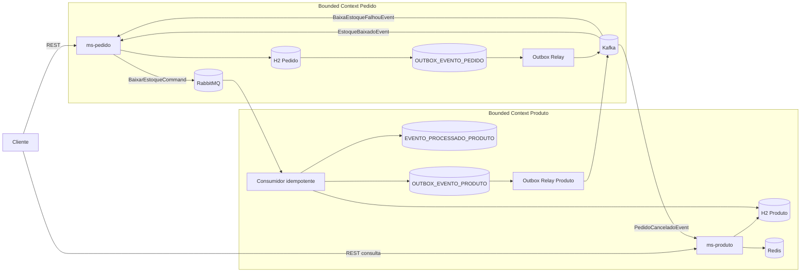
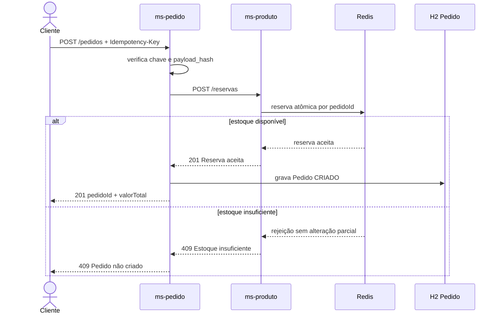
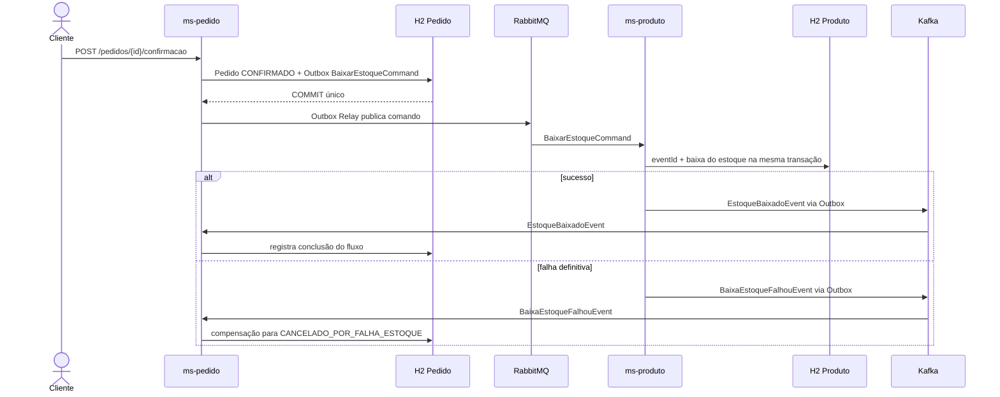

# WebMarket - Arquitetura de Software v2

## DDD, Quarkus, H2, Redis, RabbitMQ, Kafka, Outbox, idempotência, PACT e ADRs

> Projeto acadêmico com dois microsserviços: `ms-pedido` e `ms-produto`.

## 1. Objetivo

O WebMarket demonstra, de forma enxuta, os conteúdos das aulas:

- DDD estratégico e tático;
- bounded contexts e bancos segregados;
- comunicação síncrona e assíncrona;
- comando em fila e evento em tópico;
- consistência eventual e compensação;
- Redis como projeção reconstruível;
- idempotência HTTP e de consumidores;
- Transactional Outbox;
- retry, DLQ/DLT;
- contract testing com PACT;
- decisões documentadas por ADR.

## 2. Escopo

### 2.1 `ms-pedido`

Responsável por:

- criar, consultar, confirmar e cancelar pedidos;
- calcular e preservar o valor do pedido;
- aplicar a máquina de estados do agregado `Pedido`;
- garantir idempotência do `POST /pedidos`;
- persistir eventos na Outbox;
- publicar comandos no RabbitMQ e eventos no Kafka;
- reagir a falhas definitivas de estoque por compensação.

### 2.2 `ms-produto`

Responsável por:

- cadastrar e consultar produtos;
- adicionar e consultar estoque;
- manter o banco como fonte da verdade do estoque físico;
- manter no Redis uma projeção de disponibilidade;
- reservar e liberar estoque de maneira atômica;
- consumir comandos de baixa no RabbitMQ;
- garantir idempotência no processamento;
- publicar eventos de sucesso ou falha no Kafka.

### 2.3 Fora do escopo

- pagamento real;
- cálculo de frete;
- autenticação corporativa;
- promoções e cupons;
- alta disponibilidade de produção;
- event sourcing completo.

## 3. Linguagem ubíqua

| Termo | Significado |
|---|---|
| Produto | Bem disponível para compra. |
| Estoque físico | Quantidade persistida no banco do `ms-produto`. |
| Disponibilidade | Quantidade projetada no Redis para novas reservas. |
| Reserva | Separação temporária de unidades para um pedido. |
| Pedido | Agregado que reúne cliente, itens, endereço, valor e estado. |
| Confirmação | Decisão de concluir o pedido e solicitar baixa definitiva. |
| Cancelamento | Encerramento do pedido sem conclusão da compra. |
| Compensação | Operação que desfaz um efeito anterior sem apagar seu histórico. |

## 4. Bounded contexts e agregados

### 4.1 Contexto Pedido

**Aggregate Root:** `Pedido`.

Objetos internos:

- `ItemPedido`;
- `EnderecoEntrega`;
- `Dinheiro`;
- `StatusPedido`.

Invariantes:

- o pedido deve possuir pelo menos um item;
- toda quantidade deve ser positiva;
- o valor total deve ser a soma dos subtotais;
- apenas um pedido `CRIADO` pode ser confirmado;
- apenas um pedido `CRIADO` pode ser cancelado;
- objetos internos só mudam por operações da raiz `Pedido`.

Estados:

```text
CRIADO -> CONFIRMADO
CRIADO -> CANCELADO
CONFIRMADO -> CANCELADO_POR_FALHA_ESTOQUE  (compensação)
```

### 4.2 Contexto Produto

**Aggregate Root:** `Produto`.

Value Objects sugeridos:

- `ProdutoId`;
- `Dinheiro`;
- `Estoque`.

Invariantes:

- preço maior que zero;
- estoque físico nunca negativo;
- quantidade de movimentação maior que zero;
- produto inativo não aceita nova reserva;
- baixa definitiva não pode exceder o estoque físico.

## 5. Organização do projeto: um repositório, duas aplicações Quarkus

O WebMarket será mantido em **um único repositório Git e um único projeto Maven pai**, organizado como um projeto Maven multi-module. Dentro desse repositório existirão **duas aplicações Quarkus independentes**:

- `ms-pedido`: primeira aplicação Quarkus;
- `ms-produto`: segunda aplicação Quarkus.

Essa organização facilita a divisão do trabalho, a execução dos testes e o compartilhamento controlado dos pact files e da infraestrutura. Entretanto, o fato de os dois serviços estarem no mesmo repositório **não transforma os serviços em uma única aplicação**.

Cada microsserviço continuará possuindo:

- seu próprio `pom.xml`;
- seu próprio código-fonte;
- sua própria porta HTTP;
- seu próprio arquivo `application.properties`;
- seu próprio banco H2;
- seu próprio ciclo de inicialização;
- seus próprios testes;
- seu próprio empacotamento Quarkus;
- possibilidade de execução e parada independentemente do outro.

### 5.1 Estrutura multi-module Maven

```text
webmarket/
├── pom.xml                         # Maven parent/aggregator
├── ms-pedido/
│   ├── pom.xml                     # Aplicação Quarkus independente
│   └── src/
│       ├── main/java/
│       ├── main/resources/
│       │   └── application.properties
│       └── test/java/
├── ms-produto/
│   ├── pom.xml                     # Aplicação Quarkus independente
│   └── src/
│       ├── main/java/
│       ├── main/resources/
│       │   └── application.properties
│       └── test/java/
├── pacts/                          # Contratos gerados e verificados
├── infra/                          # RabbitMQ, Kafka, Redis e scripts
├── docs/
│   ├── arquitetura.md
│   └── adr/
├── AVALIACAO.md
└── README.md
```

### 5.2 `pom.xml` raiz

O `pom.xml` da raiz funciona como agregador Maven. Ele não é uma aplicação Quarkus executável.

```xml
<project xmlns="http://maven.apache.org/POM/4.0.0"
         xmlns:xsi="http://www.w3.org/2001/XMLSchema-instance"
         xsi:schemaLocation="http://maven.apache.org/POM/4.0.0 https://maven.apache.org/xsd/maven-4.0.0.xsd">
    <modelVersion>4.0.0</modelVersion>

    <groupId>br.gov.caixa.webmarket</groupId>
    <artifactId>webmarket</artifactId>
    <version>1.0.0-SNAPSHOT</version>
    <packaging>pom</packaging>

    <modules>
        <module>ms-pedido</module>
        <module>ms-produto</module>
    </modules>
</project>
```

As versões de Java, Quarkus, Pact e plugins Maven devem ser centralizadas no projeto pai quando isso não criar acoplamento de implementação entre os serviços.

### 5.3 Configuração independente do `ms-pedido`

Arquivo `ms-pedido/src/main/resources/application.properties`:

```properties
quarkus.application.name=ms-pedido
quarkus.http.port=8081

quarkus.datasource.db-kind=h2
quarkus.datasource.jdbc.url=jdbc:h2:file:./data/webmarket-pedido;DB_CLOSE_DELAY=-1
quarkus.datasource.username=sa
quarkus.datasource.password=sa
```

Endpoints principais:

```text
http://localhost:8081/pedidos
```

### 5.4 Configuração independente do `ms-produto`

Arquivo `ms-produto/src/main/resources/application.properties`:

```properties
quarkus.application.name=ms-produto
quarkus.http.port=8082

quarkus.datasource.db-kind=h2
quarkus.datasource.jdbc.url=jdbc:h2:file:./data/webmarket-produto;DB_CLOSE_DELAY=-1
quarkus.datasource.username=sa
quarkus.datasource.password=sa
```

Endpoints principais:

```text
http://localhost:8082/produtos
http://localhost:8082/reservas
```

### 5.5 Como executar os dois serviços

Cada aplicação pode ser iniciada separadamente, em terminais diferentes.

Terminal 1:

```bash
./mvnw -pl ms-pedido quarkus:dev
```

Terminal 2:

```bash
./mvnw -pl ms-produto quarkus:dev
```

Também é possível entrar no diretório de cada módulo e executar o wrapper Maven do projeto, conforme a estratégia adotada pela equipe. A condição arquitetural é que sejam iniciados como dois processos Quarkus independentes.

### 5.6 Empacotamento e execução dos artefatos

O build da raiz compila os dois módulos:

```bash
./mvnw clean verify
```

Cada módulo gera seu próprio artefato Quarkus. Portanto, é possível executar apenas um serviço, atualizar um serviço sem alterar o outro e testar cada módulo isoladamente.

### 5.7 O que não será feito

Não será adotado o seguinte desenho:

```text
uma aplicação Quarkus
└── porta 8080
    ├── /pedidos
    └── /produtos
```

Esse desenho seria um monólito modular, porque Pedido e Produto estariam na mesma JVM, no mesmo ciclo de deploy e no mesmo processo. O projeto do curso utiliza um monorepo multi-module, mas preserva duas fronteiras físicas de execução.

### 5.8 Compartilhamento de código

Os módulos não devem compartilhar entidades JPA, Aggregate Roots, repositories ou regras de domínio. Se existir código comum, ele deve se limitar a elementos técnicos pequenos e estáveis. Os contratos REST e de mensageria devem ser tratados como contratos versionados, não como classes de domínio compartilhadas que obriguem os dois serviços a evoluir juntos.

### 5.9 Relação com o PACT

A organização em um único repositório simplifica o PACT:

```text
ms-pedido
   └── gera pacts/ms-pedido-ms-produto.json

pacts/
   └── ms-pedido-ms-produto.json

ms-produto
   └── verifica o pact contra a API real
```

O pact file pode ser compartilhado pelo diretório `pacts/` durante o projeto acadêmico. Um Pact Broker somente será necessário se o grupo quiser demonstrar versionamento e compatibilidade entre builds independentes.

## 6. Arquitetura geral



## 7. Escolha de RabbitMQ e Kafka

### RabbitMQ: comando e trabalho

A confirmação do pedido gera um trabalho com um dono lógico:

```text
BaixarEstoqueCommand
```

Esse comando vai para uma fila RabbitMQ porque:

- está no imperativo: "baixe o estoque";
- existe um responsável lógico, o `ms-produto`;
- deve ser processado por uma instância consumidora;
- precisa de retry e DLQ por mensagem;
- não exige replay histórico de longo prazo.

Topologia proposta:

```text
Exchange: webmarket.commands
Routing key: estoque.baixar
Fila: estoque.baixar.q
DLX: webmarket.commands.dlx
DLQ: estoque.baixar.dlq
```

### Kafka: fatos do domínio

Os resultados são fatos no passado:

- `EstoqueBaixadoEvent`;
- `BaixaEstoqueFalhouEvent`;
- `PedidoCanceladoEvent`.

Esses fatos vão para tópicos Kafka porque podem, no futuro, interessar a mais de um consumidor e podem ser retidos e reprocessados.

Tópicos propostos:

```text
estoque-baixado
baixa-estoque-falhou
pedido-cancelado
```

Chave de partição:

```text
pedidoId
```

Todos os eventos do mesmo pedido caem na mesma partição e preservam a ordem por pedido.

## 8. Redis e fonte da verdade

O banco do `ms-produto` é a fonte da verdade do estoque. O Redis é uma projeção operacional reconstruível.

```text
Banco:
produto.quantidade_estoque = 10

Redis:
produto:{produtoId}:disponivel = 8
reserva:{pedidoId} = [{ produtoId, quantidade: 2 }]
```

A diferença representa unidades temporariamente reservadas.

### Reserva atômica

A reserva de vários itens deve ser `all-or-nothing`:

1. validar todos os saldos;
2. se algum saldo for insuficiente, não alterar nenhum;
3. se todos forem suficientes, decrementar todos;
4. registrar a reserva por `pedidoId`;
5. se o mesmo `pedidoId` for repetido, devolver o resultado anterior.

A operação deve usar script Lua no Redis ou mecanismo equivalente que execute a validação e a alteração atomicamente.

### Reconstrução

Se o Redis for perdido, o `ms-produto` deve conseguir reconstruir a disponibilidade a partir de:

```text
estoque físico no banco - reservas ainda ativas
```

Para o projeto acadêmico, pode ser implementado um endpoint administrativo ou rotina de inicialização.

## 9. Fluxos

### 9.1 Criar pedido



### 9.2 Confirmar pedido



### 9.3 Cancelar pedido antes da confirmação

1. `ms-pedido` valida que o pedido está `CRIADO`.
2. Persiste `CANCELADO` e `PedidoCanceladoEvent` na Outbox.
3. O evento é publicado no Kafka.
4. O `ms-produto` consome o evento.
5. A reserva é liberada uma única vez no Redis.

## 10. Idempotência

### 10.1 API de criação

Cabeçalho obrigatório:

```http
Idempotency-Key: 75dea32d-8d4d-43dc-a4fa-182e2abcaa30
```

Banco:

```sql
UNIQUE (idempotency_key)
```

Regras:

- chave nova: processar normalmente;
- chave existente + mesmo `payload_hash`: retornar o pedido anterior;
- chave existente + hash diferente: retornar `409 Conflict`;
- a repetição não pode fazer nova reserva.

### 10.2 Consumidor RabbitMQ

A tabela `EVENTO_PROCESSADO_PRODUTO` usa `event_id` como chave primária.

A mesma transação deve:

1. inserir `event_id`;
2. atualizar todos os produtos;
3. gravar evento de saída na Outbox do `ms-produto`;
4. efetuar commit.

Se o `event_id` já existir, o comando é considerado processado e não produz nova baixa.

### 10.3 Liberação Redis

A reserva é identificada por `pedidoId`. Liberar duas vezes deve produzir o mesmo efeito de liberar uma vez.

## 11. Outbox

Cada microsserviço publica eventos a partir da própria Outbox.

### Outbox do `ms-pedido`

Armazena:

- `BaixarEstoqueCommand` após a confirmação;
- `PedidoCanceladoEvent` após o cancelamento.

### Outbox do `ms-produto`

Armazena:

- `EstoqueBaixadoEvent`;
- `BaixaEstoqueFalhouEvent`.

O Relay pode publicar mais de uma vez se cair depois da publicação e antes de marcar `PUBLICADO`. Por isso todos os consumidores devem permanecer idempotentes.

## 12. Retry e DLQ/DLT

### RabbitMQ

- falha transitória: retry com backoff;
- falha permanente ou tentativas esgotadas: `estoque.baixar.dlq`;
- ack somente depois do commit local;
- fila durável, mensagem persistente e publisher confirms.

### Kafka

- retry por tópicos auxiliares ou mecanismo equivalente;
- tentativas esgotadas: DLT;
- commit do offset somente depois do processamento bem-sucedido;
- consumidor idempotente por `eventId`.

## 13. PACT: o que é e onde entra

PACT implementa consumer-driven contract testing. O consumidor declara exatamente o contrato de que precisa; o provedor executa o contrato contra a implementação real.

### 13.1 Contrato REST Reserva

```text
Consumer: ms-pedido
Provider: ms-produto
Interação: POST /reservas
```

O teste do `ms-pedido` gera o pact. O `ms-produto` verifica esse pact.

Contrato esperado:

```json
{
  "pedidoId": "77f14723-9538-48ce-b918-c661d95031fd",
  "itens": [
    {
      "produtoId": "54e67e66-3e00-4dd3-923c-07943825c431",
      "quantidade": 2
    }
  ]
}
```

Resposta esperada:

```json
{
  "pedidoId": "77f14723-9538-48ce-b918-c661d95031fd",
  "status": "RESERVADO"
}
```

### 13.2 Organização sugerida no código

```text
ms-pedido/
├── src/main/java/.../infrastructure/client/ProdutoReservaClient.java
├── src/test/java/.../contract/ProdutoReservaConsumerPactTest.java
└── target/pacts/ms-pedido-ms-produto.json

ms-produto/
├── src/main/java/.../presentation/ReservaResource.java
├── src/test/java/.../contract/ReservaProviderPactTest.java
└── pacts/ms-pedido-ms-produto.json
```

### 13.3 Dependências Maven conceituais

Use os módulos Pact JVM compatíveis com a versão adotada no projeto:

```xml
<dependency>
    <groupId>au.com.dius.pact.consumer</groupId>
    <artifactId>junit5</artifactId>
    <scope>test</scope>
</dependency>

<dependency>
    <groupId>au.com.dius.pact.provider</groupId>
    <artifactId>junit5</artifactId>
    <scope>test</scope>
</dependency>
```

A versão deve ser centralizada no `dependencyManagement` e validada contra o Java e o Quarkus usados pelo grupo.

### 13.4 Exemplo do consumidor Pact no `ms-pedido`

```java
@ExtendWith(PactConsumerTestExt.class)
@PactTestFor(providerName = "ms-produto", pactVersion = PactSpecVersion.V4)
class ProdutoReservaConsumerPactTest {

    @Pact(consumer = "ms-pedido")
    V4Pact reservarEstoque(PactDslWithProvider builder) {
        var request = new PactDslJsonBody()
            .uuid("pedidoId")
            .minArrayLike("itens", 1)
                .uuid("produtoId")
                .integerType("quantidade", 2)
            .closeObject()
            .closeArray();

        var response = new PactDslJsonBody()
            .uuid("pedidoId")
            .stringValue("status", "RESERVADO");

        return builder
            .given("produtos possuem estoque suficiente")
            .uponReceiving("solicitação de reserva válida")
                .path("/reservas")
                .method("POST")
                .headers("Content-Type", "application/json")
                .body(request)
            .willRespondWith()
                .status(201)
                .headers(Map.of("Content-Type", "application/json"))
                .body(response)
            .toPact(V4Pact.class);
    }

    @Test
    @PactTestFor(pactMethod = "reservarEstoque")
    void deveLerRespostaDaReserva(MockServer mockServer) {
        ProdutoReservaClient client = new ProdutoReservaClient(mockServer.getUrl());
        ReservaResponse response = client.reservar(TestData.reservaValida());
        assertEquals("RESERVADO", response.status());
    }
}
```

> Os nomes exatos de classes e métodos podem variar conforme a versão do Pact JVM. O conceito obrigatório é: o cliente REST real do `ms-pedido` deve chamar o `MockServer` do PACT, e o teste deve gerar o arquivo pact.

### 13.5 Exemplo de verificação no `ms-produto`

```java
@Provider("ms-produto")
@PactFolder("pacts")
@QuarkusTest
class ReservaProviderPactTest {

    @BeforeEach
    void configurarTarget(PactVerificationContext context) {
        context.setTarget(new HttpTestTarget("localhost", 8081));
    }

    @TestTemplate
    @ExtendWith(PactVerificationInvocationContextProvider.class)
    void verificar(PactVerificationContext context) {
        context.verifyInteraction();
    }

    @State("produtos possuem estoque suficiente")
    void prepararEstoque() {
        // Semear estado previsível no banco/Redis de teste.
    }
}
```

Em Quarkus, a porta de teste deve vir da configuração de teste, e não ficar fixa em código. O exemplo mostra a estrutura conceitual.

### 13.6 Message Pact

Depois do contrato REST, o grupo pode adicionar um message pact para `BaixarEstoqueCommand`:

```text
Consumer da mensagem: ms-produto
Provider da mensagem: ms-pedido
```

O `ms-produto` declara o payload de que precisa. O `ms-pedido` é verificado como produtor do comando. Isso testa o schema sem precisar subir o RabbitMQ.

## 14. ADR: o que é

ADR significa **Architecture Decision Record**, ou Registro de Decisão Arquitetural.

Um ADR não é uma documentação genérica da arquitetura. Cada arquivo registra uma decisão, seu contexto, alternativas e consequências.

Estrutura:

```markdown
# ADR-003: Usar RabbitMQ para baixa de estoque

## Status
Aceito

## Contexto
A confirmação do pedido precisa solicitar uma baixa de estoque a um único responsável.
O processo precisa suportar retry e DLQ sem bloquear a resposta HTTP.

## Decisão
Usar comando assíncrono BaixarEstoqueCommand em uma fila RabbitMQ.

## Alternativas consideradas
- REST síncrono: rejeitado porque acopla disponibilidade e latência.
- Kafka: rejeitado para este comando porque não precisamos de replay histórico.
- Atualização direta no banco de Produto: rejeitada porque viola a propriedade dos dados.

## Consequências
- Ganho: desacoplamento temporal, retry e DLQ.
- Custo: consistência eventual e infraestrutura adicional.
- Mitigação: idempotência, Outbox, monitoramento e compensação.
```

### ADRs obrigatórios propostos

```text
docs/adr/
├── ADR-001-bounded-contexts.md
├── ADR-002-bancos-segregados.md
├── ADR-003-rabbitmq-comando-baixa.md
├── ADR-004-kafka-eventos-dominio.md
├── ADR-005-redis-projecao-disponibilidade.md
├── ADR-006-idempotencia.md
├── ADR-007-transactional-outbox.md
├── ADR-008-consistencia-eventual-compensacao.md
└── ADR-009-contract-testing-pact.md
```

## 15. Persistência com H2 no Quarkus

Cada microsserviço possui sua própria instância lógica de H2. Não haverá banco compartilhado entre `ms-pedido` e `ms-produto`. Para o projeto acadêmico, a sugestão é executar H2 em modo arquivo no desenvolvimento, preservando os dados entre reinicializações, e usar H2 em memória nos testes automatizados.

### 15.1 Dependências Maven

No projeto Quarkus que utiliza Hibernate ORM/Panache:

```xml
<dependency>
    <groupId>io.quarkus</groupId>
    <artifactId>quarkus-hibernate-orm-panache</artifactId>
</dependency>

<dependency>
    <groupId>io.quarkus</groupId>
    <artifactId>quarkus-jdbc-h2</artifactId>
</dependency>
```

Se o grupo optar por repositories com Hibernate ORM sem Panache, a extensão de ORM deve ser ajustada à estratégia adotada, mantendo `quarkus-jdbc-h2` como driver.

### 15.2 `ms-pedido/src/main/resources/application.properties`

```properties
quarkus.datasource.db-kind=h2
quarkus.datasource.jdbc.url=jdbc:h2:file:./data/webmarket-pedido;DB_CLOSE_DELAY=-1
quarkus.datasource.username=sa
quarkus.datasource.password=sa

# Desenvolvimento acadêmico. Se Flyway/Liquibase for adotado, prefira validate/none.
quarkus.hibernate-orm.database.generation=update
quarkus.hibernate-orm.log.sql=true
```

### 15.3 `ms-produto/src/main/resources/application.properties`

```properties
quarkus.datasource.db-kind=h2
quarkus.datasource.jdbc.url=jdbc:h2:file:./data/webmarket-produto;DB_CLOSE_DELAY=-1
quarkus.datasource.username=sa
quarkus.datasource.password=sa
quarkus.hibernate-orm.database.generation=update
quarkus.hibernate-orm.log.sql=true
```

Mesmo usando H2 local, os arquivos são diferentes. Isso preserva a regra arquitetural de banco por microsserviço.

### 15.4 Perfil de teste

Nos testes, cada serviço pode usar H2 em memória:

```properties
%test.quarkus.datasource.db-kind=h2
%test.quarkus.datasource.jdbc.url=jdbc:h2:mem:webmarket;DB_CLOSE_DELAY=-1
%test.quarkus.datasource.username=sa
%test.quarkus.datasource.password=sa
%test.quarkus.hibernate-orm.database.generation=drop-and-create
```

Como cada microsserviço executa sua própria suíte de testes, o nome `webmarket` pode ser reutilizado. Para testes que iniciem ambos no mesmo processo, use nomes diferentes, como `webmarket_pedido_test` e `webmarket_produto_test`.

### 15.5 Particularidades do H2

- `UUID` pode continuar como tipo das chaves.
- `NUMERIC(15,2)` continua adequado para os valores monetários do modelo.
- Para simplificar a Outbox no projeto acadêmico, o `payload` será armazenado como `CLOB`, contendo JSON serializado pela aplicação.
- `TIMESTAMP WITH TIME ZONE` substitui o `TIMESTAMPTZ` usado anteriormente.
- As constraints `PRIMARY KEY`, `UNIQUE`, `CHECK` e `FOREIGN KEY` continuam sendo parte da garantia de integridade e idempotência.
- Não utilizar recursos específicos de H2 nos repositories ou migrations.

> O H2 é suficiente para o objetivo acadêmico, mas o desenho continua evitando acoplamento ao banco: regras de domínio ficam fora de SQL e fora das entidades de infraestrutura sempre que possível.

## 16. Modelo de dados H2

### Banco H2 do `ms-pedido`

```sql
CREATE TABLE pedido (
    pedido_id UUID PRIMARY KEY,
    cliente_id UUID NOT NULL,
    valor_total NUMERIC(15,2) NOT NULL CHECK (valor_total >= 0),
    status VARCHAR(40) NOT NULL,
    idempotency_key VARCHAR(100) NOT NULL UNIQUE,
    payload_hash VARCHAR(64) NOT NULL,
    criado_em TIMESTAMP WITH TIME ZONE NOT NULL DEFAULT CURRENT_TIMESTAMP,
    atualizado_em TIMESTAMP WITH TIME ZONE NOT NULL DEFAULT CURRENT_TIMESTAMP
);

CREATE TABLE item_pedido (
    item_pedido_id UUID PRIMARY KEY,
    pedido_id UUID NOT NULL REFERENCES pedido(pedido_id),
    produto_id UUID NOT NULL,
    quantidade INTEGER NOT NULL CHECK (quantidade > 0),
    preco_unitario NUMERIC(15,2) NOT NULL CHECK (preco_unitario > 0),
    subtotal NUMERIC(15,2) NOT NULL CHECK (subtotal > 0),
    UNIQUE (pedido_id, produto_id)
);

CREATE TABLE endereco_entrega (
    endereco_id UUID PRIMARY KEY,
    pedido_id UUID NOT NULL UNIQUE REFERENCES pedido(pedido_id),
    logradouro VARCHAR(150) NOT NULL,
    numero VARCHAR(20) NOT NULL,
    complemento VARCHAR(100),
    bairro VARCHAR(100) NOT NULL,
    cidade VARCHAR(100) NOT NULL,
    uf CHAR(2) NOT NULL,
    cep CHAR(8) NOT NULL
);

CREATE TABLE outbox_evento_pedido (
    event_id UUID PRIMARY KEY,
    agregado_id UUID NOT NULL,
    tipo_mensagem VARCHAR(100) NOT NULL,
    destino VARCHAR(120) NOT NULL,
    payload CLOB NOT NULL,
    status VARCHAR(20) NOT NULL DEFAULT 'PENDENTE',
    tentativas INTEGER NOT NULL DEFAULT 0,
    criado_em TIMESTAMP WITH TIME ZONE NOT NULL DEFAULT CURRENT_TIMESTAMP,
    publicado_em TIMESTAMP WITH TIME ZONE
);
```

### Banco H2 do `ms-produto`

```sql
CREATE TABLE produto (
    produto_id UUID PRIMARY KEY,
    nome VARCHAR(120) NOT NULL,
    descricao VARCHAR(500),
    preco NUMERIC(15,2) NOT NULL CHECK (preco > 0),
    quantidade_estoque INTEGER NOT NULL CHECK (quantidade_estoque >= 0),
    versao BIGINT NOT NULL DEFAULT 0,
    status VARCHAR(20) NOT NULL
);

CREATE TABLE evento_processado_produto (
    event_id UUID PRIMARY KEY,
    tipo_mensagem VARCHAR(100) NOT NULL,
    agregado_id UUID NOT NULL,
    processado_em TIMESTAMP WITH TIME ZONE NOT NULL DEFAULT CURRENT_TIMESTAMP
);

CREATE TABLE outbox_evento_produto (
    event_id UUID PRIMARY KEY,
    agregado_id UUID NOT NULL,
    tipo_evento VARCHAR(100) NOT NULL,
    destino VARCHAR(120) NOT NULL,
    payload CLOB NOT NULL,
    status VARCHAR(20) NOT NULL DEFAULT 'PENDENTE',
    tentativas INTEGER NOT NULL DEFAULT 0,
    criado_em TIMESTAMP WITH TIME ZONE NOT NULL DEFAULT CURRENT_TIMESTAMP,
    publicado_em TIMESTAMP WITH TIME ZONE
);
```

## 17. Divisão detalhada entre 3 integrantes

### 17.1 Igor David Morais - `ms-pedido`, PACT consumidor e integração

### Implementação principal

- estruturar o projeto Quarkus do `ms-pedido`;
- implementar `Pedido`, `ItemPedido`, `EnderecoEntrega` e `StatusPedido`;
- implementar `CriarPedidoUseCase`, `ConfirmarPedidoUseCase`, `CancelarPedidoUseCase` e `ConsultarPedidoUseCase`;
- implementar os endpoints:
  - `POST /pedidos`;
  - `GET /pedidos/{id}`;
  - `POST /pedidos/{id}/confirmacao`;
  - `POST /pedidos/{id}/cancelamento`;
- implementar o cliente REST `ProdutoReservaClient`;
- implementar `Idempotency-Key` e `payload_hash`;
- criar migrations do banco Pedido;
- implementar Outbox do `ms-pedido`;
- implementar relay para RabbitMQ e Kafka;
- produzir `BaixarEstoqueCommand`;
- consumir `EstoqueBaixadoEvent` e `BaixaEstoqueFalhouEvent`;
- aplicar compensação do pedido em falha definitiva;
- criar testes unitários do agregado e casos de uso;
- criar o teste PACT consumidor de `POST /reservas`;
- criar o provider do message pact de `BaixarEstoqueCommand`, se incluído.

### Stub/mock para trabalhar independentemente

#### Stub HTTP do `ms-produto`

Igor precisa de um stub configurável com os cenários:

```text
POST /reservas -> 201 RESERVADO
POST /reservas -> 409 ESTOQUE_INSUFICIENTE
POST /reservas -> 404 PRODUTO_NAO_ENCONTRADO
POST /reservas -> 500 ERRO_INTERNO
POST /reservas -> timeout
```

Pode usar:

- WireMock;
- MockServer do PACT no teste de contrato;
- implementação fake de `ProdutoReservaPort` nos testes unitários.

Exemplo de fake:

```java
class ProdutoReservaFake implements ProdutoReservaPort {
    private ResultadoReserva resultado;

    void responderCom(ResultadoReserva resultado) {
        this.resultado = resultado;
    }

    @Override
    public ResultadoReserva reservar(SolicitacaoReserva solicitacao) {
        return resultado;
    }
}
```

#### Fake de publicação

Criar uma porta:

```java
interface PublicadorMensagem {
    void publicar(Mensagem mensagem);
}
```

Nos testes, usar `PublicadorMensagemFake` que guarda as mensagens em memória. Assim Igor valida a Outbox e o comando gerado sem RabbitMQ ou Kafka.

#### Eventos falsos de retorno

Fixtures para:

- `EstoqueBaixadoEvent`;
- `BaixaEstoqueFalhouEvent`;
- evento duplicado;
- evento fora de ordem.

### Critério de conclusão individual

O `ms-pedido` deve funcionar com o stub do Produto, gerar o pact REST, provar idempotência HTTP e criar corretamente a mensagem de baixa na Outbox.

### 17.2 Davi Fernandez Franca Aragao - `ms-produto`, consumidor idempotente e PACT provider

### Implementação principal

- estruturar o projeto Quarkus do `ms-produto`;
- implementar `Produto`, `Estoque`, `ProdutoId` e `Dinheiro`;
- implementar casos de uso de cadastro, consulta, estoque, reserva, liberação e baixa;
- implementar endpoints:
  - `POST /produtos`;
  - `GET /produtos/{id}`;
  - `POST /produtos/{id}/estoque`;
  - `POST /reservas`;
  - `DELETE /reservas/{pedidoId}`;
- criar migrations das tabelas Produto, Evento Processado e Outbox;
- consumir `BaixarEstoqueCommand` no RabbitMQ;
- gravar `eventId`, baixar estoque e criar evento de saída na mesma transação;
- implementar optimistic locking ou atualização condicional;
- produzir `EstoqueBaixadoEvent` e `BaixaEstoqueFalhouEvent` via Outbox;
- consumir `PedidoCanceladoEvent`;
- verificar o pact REST gerado pelo `ms-pedido`;
- criar o message pact consumidor de `BaixarEstoqueCommand`, se incluído;
- criar testes de concorrência e reprocessamento.

### Stub/mock para trabalhar independentemente

#### Fake da porta Redis

Enquanto Marcos implementa Redis, Davi trabalha contra:

```java
interface ReservaEstoquePort {
    ResultadoReserva reservar(UUID pedidoId, List<ItemReserva> itens);
    void liberar(UUID pedidoId);
}
```

Implementação fake em memória:

```java
class ReservaEstoqueEmMemoria implements ReservaEstoquePort {
    private final Map<UUID, Integer> disponivel = new HashMap<>();
    private final Map<UUID, List<ItemReserva>> reservas = new HashMap<>();

    // implementação determinística para testes
}
```

Cenários obrigatórios:

- todos os itens disponíveis;
- um item insuficiente sem alteração parcial;
- reserva repetida para o mesmo pedido;
- liberação repetida;
- duas reservas concorrentes para a última unidade.

#### Stub de RabbitMQ

Nos testes unitários, chamar diretamente o método consumidor com um `BaixarEstoqueCommand` fixture. Para integração sem broker externo, usar o mecanismo de teste escolhido no perfil do projeto ou uma porta de entrada adaptável.

#### Fake de Outbox

Usar `OutboxRepositoryFake` para comprovar que sucesso e falha geram os eventos certos sem Kafka.

#### Stub de eventos

Fixtures para:

- comando de baixa válido;
- comando duplicado com mesmo `eventId`;
- comando com estoque insuficiente;
- `PedidoCanceladoEvent` repetido.

### Critério de conclusão individual

O `ms-produto` deve passar nos provider tests do PACT, processar duas vezes o mesmo comando com uma única baixa e funcionar inicialmente com a implementação fake do Redis.

### 17.3 Marcos da Silva Ferreira - Redis, infraestrutura, resiliência e testes integrados

### Implementação principal

- definir chaves e estruturas Redis;
- implementar reserva `all-or-nothing` com Lua;
- implementar reserva e liberação idempotentes por `pedidoId`;
- implementar reconstrução da projeção;
- integrar o adapter Redis à porta definida no `ms-produto`;
- criar Docker Compose com:
  - H2 do `ms-pedido`;
  - H2 do `ms-produto`;
  - Redis;
  - RabbitMQ;
  - Kafka;
- configurar fila, exchange, binding, DLX e DLQ;
- configurar tópicos Kafka, retry e DLT;
- padronizar `.env.example`, portas e health checks;
- criar coleção Bruno/Postman ou testes RestAssured;
- executar testes ponta a ponta;
- consolidar README, ADRs e roteiro da apresentação;
- monitorar e demonstrar DLQ/DLT;
- preparar evidências da reserva concorrente e do reprocessamento.

### Stub/mock para trabalhar independentemente

#### Stub do `ms-pedido`

Marcos precisa de scripts/fixtures que chamem:

```text
POST /reservas
DELETE /reservas/{pedidoId}
```

sem exigir o `ms-pedido` real.

Pode usar:

- arquivos HTTP do VS Code/IntelliJ;
- coleção Bruno/Postman;
- teste RestAssured direto no `ms-produto`;
- pequeno producer de mensagens de teste.

#### Producer fake de RabbitMQ

Publicar fixtures de `BaixarEstoqueCommand`:

- comando válido;
- comando duplicado;
- comando malformado;
- comando que provoca falha transitória;
- comando que esgota retry e vai para DLQ.

#### Producer fake de Kafka

Publicar `PedidoCanceladoEvent` para testar liberação sem depender do `ms-pedido`.

#### Consumidor espião

Criar um consumidor de teste que capture:

- `EstoqueBaixadoEvent`;
- `BaixaEstoqueFalhouEvent`.

O spy deve guardar os eventos para assertions do teste de integração.

#### Banco e APIs simulados

- migrations com dados conhecidos;
- seed de produtos;
- scripts de reset do ambiente;
- perfil de testes com portas e bancos isolados.

### Critério de conclusão individual

A infraestrutura deve subir de forma reproduzível; a reserva deve ser atômica; mensagens inválidas devem chegar à DLQ/DLT; e o fluxo integrado deve ser demonstrável mesmo usando stubs nas pontas.

## 18. Matriz de responsabilidades

| Entrega | Responsável | Revisor | Teste independente |
|---|---|---|---|
| Aggregate e API Pedido | Igor | Davi | Fake `ProdutoReservaPort` |
| Idempotência HTTP | Igor | Marcos | Banco de teste + requisição repetida |
| Outbox Pedido | Igor | Davi | `PublicadorMensagemFake` |
| Pact consumer REST | Igor | Davi | Pact MockServer |
| Aggregate e API Produto | Davi | Igor | Fake `ReservaEstoquePort` |
| Consumidor Rabbit idempotente | Davi | Marcos | chamada direta + fixtures |
| Pact provider REST | Davi | Igor | pact file do `ms-pedido` |
| Redis e Lua | Marcos | Davi | chamadas REST/adapter isolado |
| Docker Compose | Marcos | Igor | smoke test dos health checks |
| RabbitMQ/DLQ | Marcos | Davi | producer fake |
| Kafka/DLT | Marcos | Igor | producer e consumer spy |
| E2E | Marcos | Igor e Davi | ambiente integrado |
| ADRs e README | Marcos consolida | Todos | revisão cruzada |

## 19. Ordem de implementação

### Etapa 1 - Contratos

Todos juntos:

1. fechar DTOs REST;
2. fechar schemas de comando e eventos;
3. definir rotas, tópicos e fila;
4. definir DDL;
5. criar ADRs iniciais.

### Etapa 2 - Desenvolvimento paralelo

- Igor usa fake do Produto e PACT MockServer;
- Davi usa fake do Redis e mensagens fixture;
- Marcos usa requisições e producers fake.

### Etapa 3 - Contract tests

1. Igor gera o pact REST;
2. Davi copia/publica o pact no `ms-produto`;
3. Davi executa a verificação do provider;
4. pipeline falha se o contrato não for honrado.

### Etapa 4 - Integração

1. trocar fake de Redis pelo adapter real;
2. trocar stub REST pelo `ms-produto` real;
3. integrar RabbitMQ;
4. integrar Kafka;
5. validar Outbox e consumidores.

### Etapa 5 - Robustez

- repetição da mesma request;
- repetição do mesmo comando;
- falha transitória;
- poison message;
- DLQ/DLT;
- reserva concorrente;
- compensação.

## 20. Testes de aceitação

- pedido com estoque suficiente é criado;
- pedido sem estoque não é criado;
- reserva de vários itens não sofre alteração parcial;
- mesma `Idempotency-Key` e mesmo payload retornam o mesmo pedido;
- mesma chave com payload diferente retorna conflito;
- confirmação grava pedido e comando na mesma transação;
- reprocessar o comando não baixa estoque novamente;
- falha definitiva produz evento de falha e compensação;
- cancelamento libera a reserva uma única vez;
- poison message vai para DLQ;
- evento Kafka esgota retry e vai para DLT;
- PACT consumidor gera contrato;
- PACT provider verifica contrato;
- duas reservas concorrentes sobre a última unidade permitem apenas uma;
- Redis pode ser reconstruído a partir do banco e das reservas ativas.

## 21. Estrutura de repositório sugerida

```text
webmarket/
├── pom.xml                         # parent multi-module
├── ms-pedido/
│   ├── src/main/java/.../domain
│   ├── src/main/java/.../application
│   ├── src/main/java/.../infrastructure
│   ├── src/main/java/.../presentation
│   ├── src/test/java/.../unit
│   ├── src/test/java/.../contract
│   └── src/test/java/.../integration
├── ms-produto/
│   ├── src/main/java/.../domain
│   ├── src/main/java/.../application
│   ├── src/main/java/.../infrastructure
│   ├── src/main/java/.../presentation
│   ├── src/test/java/.../unit
│   ├── src/test/java/.../contract
│   └── src/test/java/.../integration
├── pacts/
├── infra/
│   ├── docker-compose.yml
│   ├── rabbitmq/
│   ├── kafka/
│   └── scripts/
├── docs/
│   ├── arquitetura.md
│   └── adr/
├── AVALIACAO.md
└── README.md
```

## 22. Definição de pronto

O projeto estará pronto quando:

- o repositório possuir um Maven parent com os módulos `ms-pedido` e `ms-produto`;
- os dois serviços subirem independentemente, em processos e portas diferentes;
- cada serviço possuir banco próprio;
- o Redis for tratado como projeção reconstruível;
- o PACT REST for gerado pelo consumidor e verificado pelo provedor;
- RabbitMQ processar o comando com consumidor idempotente e DLQ;
- Kafka publicar/consumir fatos com retry e DLT;
- Outbox impedir perda lógica entre banco e broker;
- a mesma request e a mesma mensagem não duplicarem efeitos;
- a compensação de falha definitiva funcionar;
- os ADRs registrarem alternativas e trade-offs;
- o README permitir reproduzir a execução;
- o `AVALIACAO.md` apontar cada critério para sua evidência no repositório.
