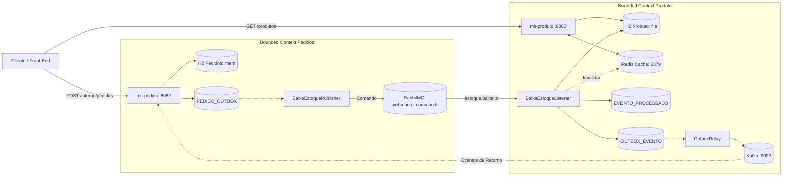

# WebMarket - Arquitetura de Software v2

## DDD, Spring Boot, H2, Redis, RabbitMQ, Kafka, Transactional Outbox, Idempotência e PACT

> Projeto acadêmico com dois microsserviços autônomos (`ms-pedido` e `ms-produto`) e um módulo compartilhado de contratos (`shared-contracts`).

---

## 1. Objetivo

O WebMarket demonstra, de forma prática e enxuta, os conceitos essenciais de microsserviços resilientes:

- DDD estratégico e tático (Bounded Contexts, Agregados e Value Objects);
- Bancos de dados segregados e desacoplamento temporal;
- Comunicação assíncrona orientada a comandos duráveis com RabbitMQ;
- Publicação de eventos de domínio com Apache Kafka;
- Cache-Aside com Redis e invalidação transacional explícita do catálogo;
- Idempotência na API HTTP e no consumidor de mensageria (`EVENTO_PROCESSADO`);
- Padrão Transactional Outbox para garantir entrega confiável (*at-least-once*);
- Contract Testing automatizado entre serviços com Pact JVM;
- Decisões de design registradas via Architecture Decision Records (ADRs).

---

## 2. Escopo

### 2.1 `ms-pedido` (Porta 8082)
- Registrar pedidos de clientes preservando o histórico de preços e itens;
- Executar gravação atômica do pedido e da mensagem na tabela outbox (`PEDIDO_OUTBOX`);
- Publicar comandos assíncronos de débito de estoque (`BaixarEstoqueCommand`) na exchange durável do RabbitMQ;
- Consumir eventos de retorno via Kafka;
- Executar como consumidor no Contract Test gerando o contrato Pact.

### 2.2 `ms-produto` (Porta 8083)
- Manter o catálogo de produtos e atuar como fonte da verdade do estoque físico;
- Prover cache de alto desempenho em Redis (`produto:<id>` e `produtos:catalogo`);
- Consumir comandos de baixa do RabbitMQ na fila durável `estoque.baixar.q`;
- Assegurar idempotência estrita via tabela `EVENTO_PROCESSADO`;
- Invalidar o cache do Redis de forma transacional após o commit da baixa de estoque;
- Registrar eventos de sucesso/falha na outbox (`OUTBOX_EVENTO`) para despacho no Kafka;
- Executar como provedor no Contract Test validando as regras do pacto.

### 2.3 `shared-contracts`
- Módulo Maven local contendo DTOs, esquemas de eventos e contratos comuns para serialização e validação.

### 2.4 Fora do escopo
- Gateway de pagamento real;
- Cálculo dinâmico de frete e rastreamento logístico;
- Autenticação e autorização corporativa (OAuth2/Keycloak);
- Event Sourcing com replay integral.

---

## 3. Linguagem Ubíqua

| Termo | Significado | Representação no Código |
|---|---|---|
| **Produto** | Bem cadastrado no catálogo com preço e saldo de estoque físico. | `ProdutoEntity`, `ProdutoView` |
| **Estoque Físico** | Quantidade real disponível no banco do `ms-produto` (não negativo). | `quantidadeEstoque` (Integer) |
| **Pedido** | Registro da intenção de compra aceita e persistida. | `PedidoEntity`, `GravarPedidoCommand` |
| **Item do Pedido** | Associação entre produto, quantidade e preço congelado no momento da venda. | `ItemPedidoEntity` |
| **Baixar Estoque** | Comando imperativo para dedução do saldo físico. | `BaixaEstoqueMessage` |
| **Idempotência** | Mecanismo que garante que um comando repetido produza uma única alteração. | `EVENTO_PROCESSADO` |

---

## 4. Bounded Contexts e Agregados

### 4.1 Contexto Pedidos (`ms-pedido`)
- **Aggregate Root:** `PedidoEntity`
  - Identificador lógico: `identificadorPedido` (UUID) e chave interna `id` (Long/Integer).
  - Entidade interna: `ItemPedidoEntity` (com `produtoId`, `quantidade`, `precoUnitario`).
  - Invariantes: lista de itens não vazia, quantidades estritamente positivas e unicidade de pedido.
  - Ordenação interna mapeada por `@OrderBy("id")`.

### 4.2 Contexto Catálogo e Estoque (`ms-produto`)
- **Aggregate Root:** `ProdutoEntity`
  - Atributos: `id` (Integer), `nome`, `preco` (BigDecimal), `quantidadeEstoque` (Integer), `ativo` (Boolean).
  - Invariantes: preço maior que zero, saldo físico nunca negativo e proibição de baixa para produtos inativos.

---

## 5. Organização do Projeto: Maven Multi-Module

O projeto adota uma estrutura monorepo multi-module com **duas aplicações Spring Boot independentes** e um módulo compartilhado:

```text
webmarket/
├── pom.xml                         # Maven parent/aggregator
├── shared-contracts/               # Módulo compartilhado de contratos
│   └── pom.xml
├── ms-pedido/                      # Aplicação Spring Boot (Porta 8082)
│   ├── pom.xml
│   └── src/
│       ├── main/java/.../gravador/
│       └── test/java/.../contract/ProdutoConsumerContractTest.java
├── ms-produto/                     # Aplicação Spring Boot (Porta 8083)
│   ├── pom.xml
│   └── src/
│       ├── main/java/.../produto/
│       └── test/java/.../contract/ProdutoProviderContractTest.java
├── infra/                          # Docker e scripts de suporte
├── docs/                           # Documentação e ADRs
└── README.md
```

### Configurações de Execução

- **`ms-pedido` (`application.yml`):**
  - Porta: `8082`
  - Banco: `jdbc:h2:mem:pedidos` (Console H2: `http://localhost:8082/h2-console`)
- **`ms-produto` (`application.yml`):**
  - Porta: `8083`
  - Banco: `jdbc:h2:file:./data/webmarket-produto` (Console H2: `http://localhost:8083/h2-console`)
  - Cache: Redis em `localhost:6379`

---

## 6. Arquitetura e Mensageria



### Divisão de Papéis de Mensageria

1. **RabbitMQ (Comandos e Trabalho Assíncrono):**
   - **Exchange:** `webmarket.commands` (Direct / Durable)
   - **Routing Key:** `estoque.baixar`
   - **Queue:** `estoque.baixar.q` (Durable)
   - **DLQ:** `gravacao.dlq`
   - Desacopla a gravação do pedido da disponibilidade do estoque. Se o `ms-produto` estiver desligado, o RabbitMQ preserva a mensagem na fila sem perda de dados.

2. **Apache Kafka (Fatos de Domínio):**
   - Tópico: `estoque-eventos`
   - Armazena eventos no passado (`EstoqueBaixadoEvent`, `BaixaEstoqueFalhouEvent`) para auditoria e histórico de integrações.

---

## 7. Cache-Aside com Redis e Invalidação Explícita

O banco H2 do `ms-produto` é a fonte da verdade. O Redis atua exclusivamente como cache rápido de leitura:

- **Componente:** `ProdutoCatalogoService` com `StringRedisTemplate`.
- **Chaves:**
  - `produto:<id>` (ex: `produto:1` armazenando o JSON completo).
  - `produtos:catalogo` (lista completa dos itens ativos).
- **TTL:** 10 minutos com serialização JSON Jackson.
- **Invalidação Transacional:** Ao concluir o débito de estoque, o `ProdutoCatalogoService.invalidarCache(produtoId)` expurga imediatamente as chaves do produto e do catálogo do Redis.

---

## 8. Idempotência e Consistência

1. **API HTTP (`ms-pedido`):** Recebe o `identificadorPedido` (UUID) para rejeitar duplicações na tabela `PEDIDO`.
2. **Consumidor RabbitMQ (`ms-produto`):**
   - Tabela de controle: `EVENTO_PROCESSADO` com chave primária em `event_id`.
   - Antes de iniciar o débito, valida:
     ```java
     if (eventoProcessadoRepository.existsById(message.getEventId())) {
         log.warn("Evento {} já processado. Ignorando.", message.getEventId());
         return;
     }
     ```
   - O débito do estoque, a inserção na `EVENTO_PROCESSADO` e a gravação na outbox ocorrem na mesma transação `@Transactional`.

---

## 9. Contract Testing com Pact JVM

O contrato entre os serviços é validado de forma automatizada sem acoplamento de runtime:

- **Consumidor:** `ms-pedido` (`ProdutoConsumerContractTest.java`)
  - Especificação: `V4Pact`
  - Endpoint verificado: `GET /produtos/1`
  - Saída: `ms-pedido/target/pacts/ms-pedido-ms-produto.json`
- **Provedor:** `ms-produto` (`ProdutoProviderContractTest.java`)
  - Configuração: `@Provider("ms-produto")` e `@PactFolder("../ms-pedido/target/pacts")`.
  - Isolamento de infraestrutura: Kafka e Outbox mockados via `@MockitoBean` para permitir teste puramente HTTP.
- **Estrutura Validada do Contrato:**
  ```json
  {
    "id": 1,
    "nome": "Notebook",
    "preco": 3500.00,
    "quantidadeEstoque": 10,
    "ativo": true
  }
  ```

---

## 10. Modelo de Dados Físico (H2 Database)

### Banco `ms-pedido` (`jdbc:h2:mem:pedidos`)

```sql
CREATE TABLE pedido (
    id BIGINT AUTO_INCREMENT PRIMARY KEY,
    identificador_pedido VARCHAR(64) NOT NULL UNIQUE,
    id_cliente BIGINT NOT NULL,
    situacao VARCHAR(30) NOT NULL,
    valor_total NUMERIC(15,2),
    data_pedido TIMESTAMP NOT NULL
);

CREATE TABLE item_pedido (
    id BIGINT AUTO_INCREMENT PRIMARY KEY,
    pedido_id BIGINT NOT NULL REFERENCES pedido(id),
    produto_id INTEGER NOT NULL,
    quantidade INTEGER NOT NULL CHECK (quantidade > 0),
    preco_unitario NUMERIC(15,2)
);

CREATE TABLE pedido_outbox (
    id BIGINT AUTO_INCREMENT PRIMARY KEY,
    identificador_evento VARCHAR(64) NOT NULL UNIQUE,
    tipo VARCHAR(100) NOT NULL,
    payload CLOB NOT NULL,
    status VARCHAR(20) NOT NULL,
    criado_em TIMESTAMP NOT NULL
);
```

### Banco `ms-produto` (`jdbc:h2:file:./data/webmarket-produto`)

```sql
CREATE TABLE produto (
    id INTEGER AUTO_INCREMENT PRIMARY KEY,
    nome VARCHAR(120) NOT NULL,
    preco NUMERIC(15,2) NOT NULL CHECK (preco > 0),
    quantidade_estoque INTEGER NOT NULL CHECK (quantidade_estoque >= 0),
    ativo BOOLEAN NOT NULL DEFAULT TRUE
);

CREATE TABLE evento_processado (
    event_id VARCHAR(64) PRIMARY KEY,
    processado_em TIMESTAMP NOT NULL
);

CREATE TABLE outbox_evento (
    event_id VARCHAR(64) PRIMARY KEY,
    tipo_evento VARCHAR(100) NOT NULL,
    payload CLOB NOT NULL,
    status VARCHAR(20) NOT NULL DEFAULT 'PENDENTE',
    criado_em TIMESTAMP NOT NULL
);
```

---

## 11. Comandos de Validação e Execução

### Compilar e Instalar Contratos
```bash
./mvnw -pl shared-contracts install -DskipTests
./mvnw clean compile -DskipTests
```

### Rodar os Testes de Contrato
```bash
./mvnw -pl ms-pedido -am test -Dtest=ProdutoConsumerContractTest
./mvnw -pl ms-produto -am test -Dtest=ProdutoProviderContractTest
```

### Executar os Microsserviços
```bash
# Terminal 1 - ms-produto
./mvnw -pl ms-produto spring-boot:run

# Terminal 2 - ms-pedido
./mvnw -pl ms-pedido spring-boot:run
```